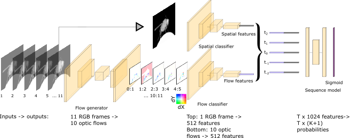

# DeepEthogram
- Written by Jim Bohnslav, except where as noted
- JBohnslav@gmail.com

DeepEthogram is an open-source package for automatically classifying each frame of a video into a set of pre-defined
behaviors. Designed for neuroscience research, it could be used in any scenario where you need to detect actions from
each frame of a video.

Example use cases:
* Measuring itching or scratching behaviors to assess the differences between wild-type and mutant animals
* Measuring the amount of time animals spend courting, and comparing between experimental conditions
* Counting licks from video for appetite measurement
* Measuring reach onset times for alignment with neural activity

DeepEthogram uses state-of-the-art algorithms for *temporal action detection*. We build on the following previous machine
learning research into action detection:
* [Hidden Two-Stream Convolutional Networks for Action Recognition](https://arxiv.org/abs/1704.00389)
* [Temporal Gaussian Mixture Layer for Videos](https://arxiv.org/abs/1803.06316)



## Installation
DeepEthogram recently migrated from Miniconda/pip to [uv](https://docs.astral.sh/uv/). Current releases are uv-first,
recommend Python 3.11, support Python `>=3.9,<3.12`, and use PySide6 for the GUI.

Install uv first:

```bash
curl -LsSf https://astral.sh/uv/install.sh | sh
# or
brew install uv
```

For development from this repository:

```bash
git clone https://github.com/jbohnslav/deepethogram.git
cd deepethogram
uv sync
uv run deepethogram
```

For a user install:

```bash
uv pip install deepethogram
```

Detailed setup, troubleshooting, and legacy conda/pip instructions for older releases are in [docs/installation.md](docs/installation.md).

## Data
**NEW!** All datasets collected and annotated by the DeepEthogram authors are now available from this DropBox link:
https://www.dropbox.com/sh/3lilfob0sz21och/AABv8o8KhhRQhYCMNu0ilR8wa?dl=0

If you have issues downloading the data, please raise an issue on Github.

## COLAB
I've written a Colab notebook that shows how to upload your data and train models. You can also use this if you don't
have access to a decent GPU.

To use it, please [click this link to the Colab notebook](https://colab.research.google.com/drive/1Nf9FU7FD77wgvbUFc608839v2jPYgDhd?usp=sharing).
Then, click `copy to Drive` at the top. You won't be able to save your changes to the notebook as-is.


## News
We now support docker! Docker is a way to run `deepethogram` in completely reproducible environments, without interacting
with other system dependencies. [See docs/Docker for more information](docs/docker.md)

## Pretrained models

Download individual models from the [DeepEthogram Hugging Face collection](https://huggingface.co/collections/jbohnslav/deepethogram-pretrained-models-6ad61e8af1ac368c56d8deec).
Each model has its own weights, model card, configuration, license, and checksum manifest.

| Model | Role | Typical use |
| --- | --- | --- |
| [TinyMotionNet](https://huggingface.co/jbohnslav/deepethogram-tinymotionnet) | Optical-flow generator | DEG-f flow initialization |
| [MotionNet](https://huggingface.co/jbohnslav/deepethogram-motionnet) | Optical-flow generator | DEG-m flow initialization |
| [TinyMotionNet3D](https://huggingface.co/jbohnslav/deepethogram-tinymotionnet3d) | Optical-flow generator | 3D optical flow |
| [DEG-f](https://huggingface.co/jbohnslav/deepethogram-deg-f) | Feature extractor | Fast behavior feature-extractor initialization |
| [DEG-m](https://huggingface.co/jbohnslav/deepethogram-deg-m) | Feature extractor | Medium behavior feature-extractor initialization |
| [DEG-s](https://huggingface.co/jbohnslav/deepethogram-deg-s) | Feature extractor | Slow behavior feature-extractor initialization |

For DEG-f, install the [Hugging Face CLI](https://huggingface.co/docs/huggingface_hub/guides/cli)
and download its flow generator and feature extractor into your existing project's model directory:

```bash
hf download jbohnslav/deepethogram-tinymotionnet --revision v1.0 --local-dir /path/to/project/models/pretrained_models/200221_115158_TinyMotionNet
hf download jbohnslav/deepethogram-deg-f --revision v1.0 --local-dir /path/to/project/models/pretrained_models/200415_125824_hidden_two_stream_kinetics_degf
```

Run `shasum -a 256 -c SHA256SUMS` inside each downloaded run directory to verify its files.
See [pretrained model setup](docs/pretrained_models.md) for DEG-m, individual downloads, and loading details.
These weights initialize training on your own data; they do not classify your behavior labels without fine-tuning.

The [legacy bundle](https://huggingface.co/jbohnslav/deepethogram-pretrained) retains the original six-folder archive,
including the incomplete DEG-s feature extractor. It is available for historical compatibility.

## Licensing
Copyright (c) 2020 - President and Fellows of Harvard College. All rights reserved.

This software is free for academic use. For commercial use, please contact the Harvard Office of Technology
Development (hms_otd@harvard.edu) with cc to Dr. Chris Harvey. For details, see [license.txt](license.txt).

## Usage
### [To use the GUI, click](docs/using_gui.md)
#### [To use the command line interface, click](docs/using_CLI.md)

## Dependencies
The major dependencies for DeepEthogram are as follows:
* pytorch, torchvision: all the neural networks, training, and inference pipelines were written in PyTorch
* pytorch-lightning: for nice model training base classes
* kornia: for GPU-based image augmentations
* PySide6: for the GUI
* opencv: for video and image reading and writing
* opencv_transforms: for fast image augmentation
* scikit-learn, scipy: for binary classification metrics
* matplotlib: plotting metrics and neural network outputs
* pandas: reading and writing CSVs
* h5py: saving inference outputs as HDF5 files
* omegaconf: for smoothly integrating configuration files and command line inputs
* tqdm: for nice progress bars

## Hardware requirements
For GUI usage, we expect that the users will be working on a local workstation with a good NVIDIA graphics card. For training via a cluster, you can use the command line interface.

* CPU: 4 cores or more for parallel data loading
* Hard Drive: SSD at minimum, NVMe drive is better.
* GPU: DeepEthogram speed is directly related to GPU performance. An NVIDIA GPU is absolutely required, as PyTorch uses
CUDA, while AMD does not.
The more VRAM you have, the more data you can fit in one batch, which generally increases performance. a
I'd recommend 6GB VRAM at absolute minimum. 8GB is better, with 10+ GB preferred.
Recommended GPUs: `RTX 3090`, `RTX 3080`, `Titan RTX`, `2080 Ti`, `2080 super`, `2080`, `1080 Ti`, `2070 super`, `2070`
Some older ones might also be fine, like a `1080` or even `1070 Ti`/ `1070`.

## testing
Test coverage is still low, but in the future we will be expanding our unit tests.

Prepare the video fixtures and the same Hugging Face checkpoints documented above:

```bash
uv sync --locked --dev
uv run python setup_tests.py
```

Video fixtures still come from the existing test archive. All six pretrained models are downloaded
from the individual Hugging Face repos at the exact commits in [`huggingface/models.json`](huggingface/models.json)
and verified against checked-in checksums, even when the video fixtures already exist.
CPU CI and the Modal GPU test runner use this setup. The CPU suite checks checkpoint identity,
strict parameter loading, forward-pass outputs, and project discovery for all six releases.

To run tests:
```bash
# Run all tests except GPU tests (default)
uv run pytest tests/

# Run only GPU tests (requires NVIDIA GPU)
uv run pytest -m gpu

# Run all tests including GPU tests
uv run pytest -m ""
```

GPU tests are skipped by default as they require significant computational resources and time to complete. These tests perform end-to-end model training and inference.

## Developer Guide
### Code Style and Pre-commit Hooks
We use pre-commit hooks to maintain code quality and consistency. The hooks include:
- Ruff for Python linting and formatting
- Various file checks (trailing whitespace, YAML validation, etc.)

To set up the development environment:

1. Install the development dependencies:
```bash
uv sync --dev
```

2. Install pre-commit hooks:
```bash
uvx pre-commit install
```

The hooks will run automatically on every commit. You can also run them manually on all files:
```bash
uvx pre-commit run --all-files
```

## Changelog
* 0.1.4: bugfixes for dependencies; added docker
* 0.1.2/3: fixes for multiclass (not multilabel) training
* 0.1.1.post1/2: batch prediction
* 0.1.1.post0: flow generator metric bug fix
* 0.1.1: bug fixes
* 0.1: deepethogram beta! See above for details.
* 0.0.1.post1: bug fixes and video conversion scripts added
* 0.0.1: initial version
